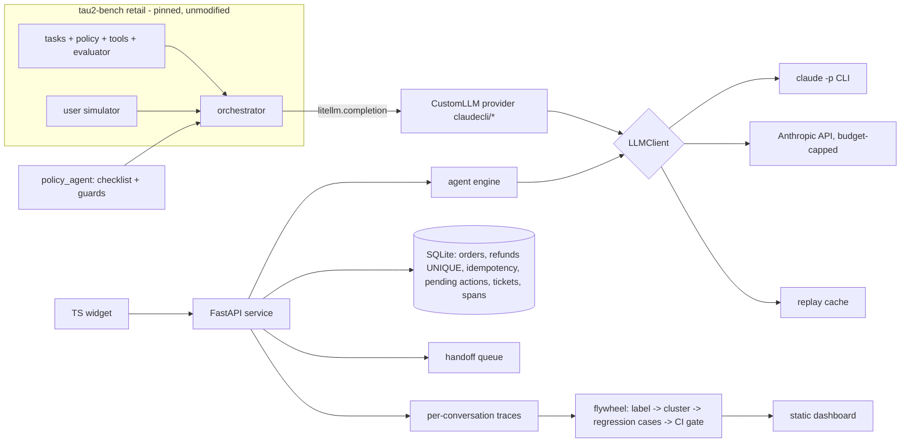

# support-agent-evals

[](https://github.com/TonyLee-99/support-agent-evals/actions/workflows/ci.yml)
[](LICENSE)

**A customer-support agent measured honestly: on Sierra's tau2-bench retail (unmodified), the policy agent reaches
pass^2 = 80% vs 50% for tau2's default agent on a frozen 10-task test subset (pass^1 85% vs 70%), and the
production-shaped service around it cannot double-refund or act on another customer's order by construction.**


| business problem | what I built | measured results |
|---|---|---|
| A retailer wants a bot for returns/exchanges/cancellations but cannot tell whether it is safe or improving | Policy agent (checklist prompt + code guards) on tau2-bench; FastAPI chat service + TS widget with confirmation cards, idempotent refunds, ownership checks, handoff queue, traces; eval flywheel (taxonomy -> clusters -> regression cases -> CI gate) | tau2 retail test subset (10 tasks, k=2, Haiku 5.5): pass^1 **85%** vs **70%** baseline (paired +15 pts, CI 0 to +30); pass^2 **80%** vs **50%**. Service: 33 deterministic acceptance tests incl. 32-thread double-refund race. Own scenarios and judge calibration: see Results |

## Architecture



Design: [docs/DESIGN.md](docs/DESIGN.md). Decisions: [docs/decisions/](docs/decisions/).

## Run it (offline, no API key, <= 3 commands)
```
make init          # pinned tau2 checkout, uv sync, widget deps
make check         # lint + types + tests + widget + regression gate, all on the replay cache (zero LLM calls)
open docs/site/index.html
```
Live paths: `make tau2 N=10 K=2` (Anthropic API, budget-guarded), `make dev`, `make scenarios`, `make flywheel`,
`make regress`. Sizes are knobs; see [docs/EVAL.md](docs/EVAL.md) section 5 for CI width and how to scale.

## Results

### tau2-bench retail (frozen 10-task subset of the official test split, k=2)
| agent | pass^1 [95% CI] | pass^2 [95% CI] | DB-only pass^1 |
|---|---|---|---|
| baseline: tau2 `llm_agent` (default prompt) | 70% [50, 90] | 50% [20, 80] | see results |
| policy_agent (checklist + guards) | 85% [65, 100] | 80% [50, 100] | see results |

Paired difference pass^1: +15 pts, CI [0, +30], 3 tasks better, 0 worse, 7 same
(`results/tau2_test_summary.json`). Agent, user simulator and NL grader are all `claude-haiku-5-5`; not
comparable to the public leaderboard (every difference is listed in the summary file and on the dashboard).

### Own scenarios, judge, flywheel
Filled from `results/scenarios_summary.json`, `results/judge_calibration.json`, `results/flywheel/taxonomy.json`,
`results/regression/report_*.json` (see [docs/EVAL.md](docs/EVAL.md)).

## Simulated vs real
- **Real:** tau2-bench tasks/policy/evaluator; every LLM call and score in `results/`; the service code and its
  tests; codex-written scenarios (really written blind by another model); API spend in the ledger.
- **Simulated:** customers (LLM user simulators), store data (tau2's synthetic retail DB), the discovery
  interview ([docs/DISCOVERY.md](docs/DISCOVERY.md) is labelled Simulated), the demo login, the widget
  screenshot (scripted model so it is reproducible).

## Limitations
Small samples (10 tasks x 2 trials; 20 scenarios; 10 calibration items) - read the CIs. Same model family plays
agent, customer and judge. Tool calling is emulated over JSON, so results are specific to this interface.

## From demo to production
Postgres instead of SQLite (same transaction shape), real SSO instead of the demo login, a separate ops UI for
the handoff queue, a 5% shadow-traffic sample graded weekly, and the rollout plan in
[docs/ROLLOUT.md](docs/ROLLOUT.md) (shadow -> 5% -> 25% -> GA with guardrails and a kill switch).

## How I used Claude Code and how I verified it
The code was written with Claude Code. Verification did not rely on it: tau2's own evaluator scores the benchmark;
service invariants are deterministic tests with real threads; half the scenarios and one of the two judge graders
are ChatGPT (codex), blind to the agent; an independent codex review checked the design before coding and the
results at the end (`reviews/` is local-only).
