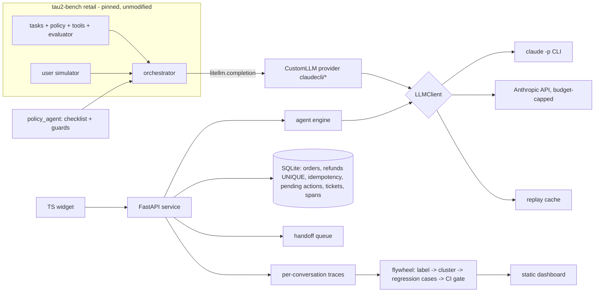

# support-agent-evals

[](https://github.com/TonyLee-99/support-agent-evals/actions/workflows/ci.yml)
[](LICENSE)

**An eval pipeline for a support agent that caught its own false win:** a +15-pt lift on a 10-task tau2-bench
subset vanished on all 40 retail test tasks x 3 trials (pass^1 80% vs 83%, paired -2 pts, CI [-8, +4]), so the claim
was retracted. The service around the agent cannot double-refund or act on another customer's order.

| | |
|---|---|
| **Problem** | A retailer wants a bot for returns/exchanges/cancellations but cannot tell if it is safe or improving |
| **Built** | Guarded agent on tau2-bench; FastAPI + TS chat service with confirmation cards, idempotent refunds, ownership checks, handoff queue, traces; flywheel: failure labels -> clusters -> regression cases -> CI gate |
| **Measured** | tau2 (40 tasks, k=3): no lift over tau2's default agent. Service: 38 deterministic tests incl. a 32-thread double-refund race. 20 own scenarios: checks 90% -> 100%, judge 35% -> 80% (v3) |


## Architecture



Design: [docs/DESIGN.md](docs/DESIGN.md). Decisions: [docs/decisions/](docs/decisions/).

## Run it (offline, no API key, <= 3 commands)
```
make init          # pinned tau2 checkout, uv sync, widget deps
make check         # lint + types + tests + widget + regression gate, all on the replay cache (zero LLM calls)
open docs/site/index.html
```
Live paths: `make tau2 N=10 K=2` (Anthropic API, budget-guarded), `make dev`, `make scenarios`, `make flywheel`,
`make regress`. Sizes are knobs; see [docs/EVAL.md](docs/EVAL.md) section 5 for CI width and how to scale.

## Results

### tau2-bench retail (all 40 tasks of the official test split, k=3)
| agent | pass^1 [95% CI] | pass^2 [95% CI] | pass^3 [95% CI] | DB-only pass^1 |
|---|---|---|---|---|
| baseline: tau2 `llm_agent` (default prompt) | 83% [73, 92] | 74% [62, 87] | 69% [54, 82] | 83% |
| policy_agent (checklist + guards) | 80% [71, 89] | 71% [58, 83] | 67% [51, 82] | 81% |

Paired difference pass^1: -2 pts, CI [-8, +4], 6 tasks better, 7 worse, 27 same (pass^3: -5 pts, CI [-18, +11])
(`results/tau2_test_summary.json`). 240 simulations planned, 238 kept (119 per agent). The summary
counts failed *attempts* separately: baseline 2, policy agent 3. Each agent has one simulation that failed twice
(once in the main run, again on re-run, because the bad reply is cached) - baseline task 94 trial 2, policy task
27 trial 0, both a malformed `transfer_to_human_agents` call (INC-9) - and the policy agent's third attempt was an
NL-grader parse error on task 111 trial 2 that succeeded on re-run. Missing simulations are never scored as
failures; their task is left out of pass^3 only. **The earlier 10-task x 2-trial run showed +15 pts (CI [0, +30],
`results/tau2_test10_summary.json`); on the full split that lift disappears.** Those 10 tasks were a seeded
random draw made before tuning, so the gap is sampling noise in a small subset, not test-set tuning. Agent, user simulator and NL grader are all `claude-haiku-5-5`; not
comparable to the public leaderboard (every difference is listed in the summary file and on the dashboard).

The confirmation gate fired 34 times in the policy agent's 119 test simulations (writes attempted before an
explicit yes) without improving the score: tau2's simulated customers usually say yes anyway, so on this benchmark
the guard changes the turn order more than the outcome. Of the 44 failed test simulations, the labeller attributes
17 to the user simulator (`results/flywheel/test_taxonomy_descriptive.json`, descriptive only). Dev ablations are **directional only** (10 tasks x 1 trial; every CI includes 0, e.g. without the checklist
prompt -20 pts, CI [-60, +20]; `results/ablations.json`).

> **Threats to validity**
> - **Tool-calling interface.** Tools are called through a JSON `respond` wrapper, not native per-tool function
>   calling. In the 40 x 3 run the adapter saw 31 (baseline) and 28 (policy) invalid agent outputs that needed a
>   retry, and across all API runs 212 replies called a tool directly instead of through the wrapper and were
>   mapped (INC-1, INC-9).
>   Scores are specific to this interface.
> - **One model plays every role.** `claude-haiku-5-5` is the agent, the simulated customer, tau2's NL grader and
>   the scenario judge; same-family accommodation can inflate or deflate both agents alike.
> - **Next experiment:** rerun both agents with native tool calling on 40 x 3 and a different-family user
>   simulator. Estimated cost on Haiku 5.5: about $2.0-2.5 for the tool-calling rerun (measured ~$0.01 per
>   simulation, 240 simulations), plus the simulator's own price. Not run: no budget left this round.

### Own scenarios on the service stack (20 of 100: 10 self-written + 10 codex-blind; 11 are holdout)
| run | deterministic checks | LLM judge pass | note |
|---|---|---|---|
| scen_baseline_20 | 90% | 35% | tau2 default prompt on the service |
| scen_v1_20 | 90% | 40% | checklist + service rules |
| scen_v2_20 | 95% | 75% | v1 + prompt lessons from dev failures (rejected by the gate) |
| scen_v3_20 | 100% | 80% | v1 + adapter fix for the root cause (shipped) |

Deterministic checks: refund rows, order states, forbidden tools, data-leak strings, handoff tickets; leak rate 0%
in every run. Holdout-only (n=11) for v3: deterministic 100%, judge 73% (`results/scenarios_summary.json`).

### Flywheel and CI gate
22 labelled dev failures; the largest embedding cluster (16) is "invented tool outages". Tracing it showed an
interface artifact: through the CLI the model sometimes tried a native tool call, got "No such tool available",
and repeated that to the customer ([INC-8](docs/INCIDENTS.md)). Regression suite (17 service cases: 12 mined +
5 safety seeds, 3 fresh draws each, all must pass), service pass rate - v1: 0.71, v2: 0.65, v3: 0.94, broken
agent: 0.53. The gate ships v3 and blocks v1, v2 (two new failures) and the deliberately broken agent.

### Judge calibration (n=40: every baseline and v1 scenario conversation)
Judge vs an independent Claude grader and vs ChatGPT (codex): 90% agreement (CI 80-98%), kappa 0.79 each
(95% CI 0.56-0.95); the two graders agree 100% with each other. In the 4 disagreements the graders outvote the
judge (3 stricter, 1 more lenient). The first calibration used n=10 and gave kappa 0.74 with CI 0.00-1.00, which
says nothing at that size; it is kept as `results/judge_calibration_n10.json`. Both graders are models, not human
support experts (`results/judge_calibration.json`).

### Cost
Anthropic API (Haiku 5.5): $0.46 for 1,050 calls (both agents on the test subset, incl. discarded runs; shared cap
$3.50). Subscription CLI: 2,481 live calls, $2.62 list-price equivalent, not billed (`results/ledger_summary.json`).

## Simulated vs real
- **Real:** tau2-bench tasks/policy/evaluator; every LLM call and score in `results/`; the service code and its
  tests; codex-written scenarios (really written blind by another model); API spend in the ledger.
- **Simulated:** customers (LLM user simulators), store data (tau2's synthetic retail DB), the discovery
  interview ([docs/DISCOVERY.md](docs/DISCOVERY.md) is labelled Simulated), the demo login, the widget
  screenshot (scripted model so it is reproducible).

## Limitations
Small samples outside the benchmark (20 scenarios; 40 calibration items) - read the CIs. On tau2 the policy
agent shows no lift over the default agent at N=40, k=3. Same model family plays
agent, customer and judge. Tool calling is emulated over JSON, so results are specific to this interface.

## From demo to production
Postgres instead of SQLite (same transaction shape), real SSO instead of the demo login, a separate ops UI for
the handoff queue, a 5% shadow-traffic sample graded weekly, and the rollout plan in
[docs/ROLLOUT.md](docs/ROLLOUT.md) (shadow -> 5% -> 25% -> GA with guardrails and a kill switch).

## How the results were verified
The benchmark is scored by tau2's own evaluator; service invariants are deterministic tests with real threads; half the
scenarios and one of the two judge graders are ChatGPT (codex), blind to the agent; the design was reviewed by an
independent reviewer before coding and the results again at the end.
