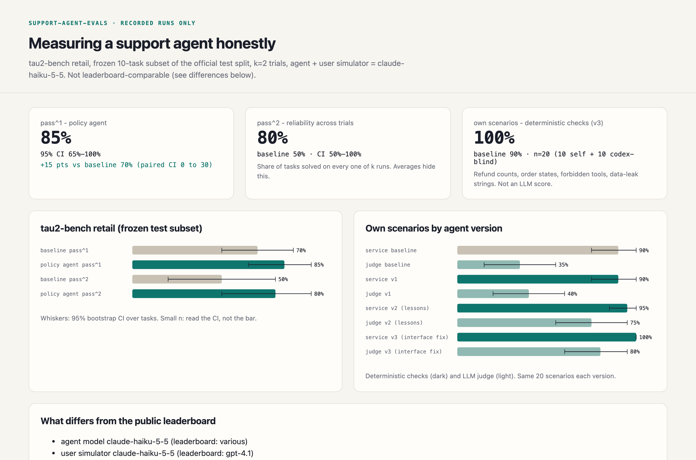
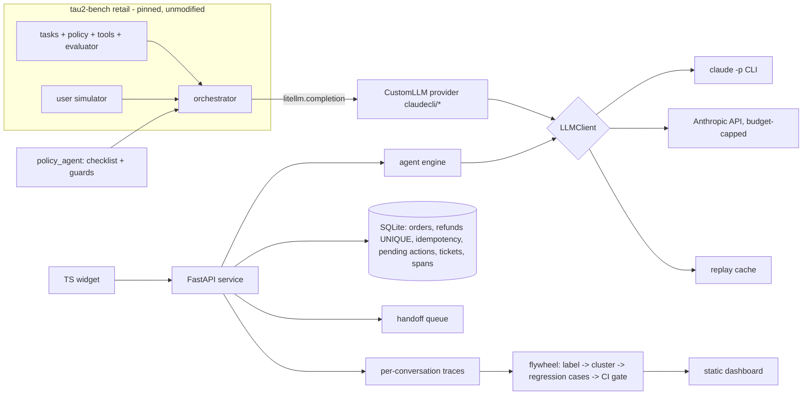

# support-agent-evals

[](https://github.com/TonyLee-99/support-agent-evals/actions/workflows/ci.yml)
[](LICENSE)

**A customer-support agent measured honestly: on Sierra's tau2-bench retail (unmodified), the policy agent reaches
pass^2 = 80% vs 50% for tau2's default agent on a frozen 10-task test subset (pass^1 85% vs 70%), and the
production-shaped service around it cannot double-refund or act on another customer's order by construction.**



| business problem | what I built | measured results |
|---|---|---|
| A retailer wants a bot for returns/exchanges/cancellations but cannot tell whether it is safe or improving | Policy agent (checklist prompt + code guards) on tau2-bench; FastAPI chat service + TS widget with confirmation cards, idempotent refunds, ownership checks, handoff queue, traces; eval flywheel (taxonomy -> clusters -> regression cases -> CI gate) | tau2 retail test subset (10 tasks, k=2, Haiku 5.5): pass^1 **85%** vs **70%** baseline (paired +15 pts, CI 0 to +30); pass^2 **80%** vs **50%**. Service: 32 deterministic acceptance tests incl. a 32-thread double-refund race (exactly 1 refund). Own scenarios (20): deterministic checks 90% -> **100%**, judge pass 35% -> **80%** (baseline -> shipped v3) |

## Architecture



Design: [docs/DESIGN.md](docs/DESIGN.md). Decisions: [docs/decisions/](docs/decisions/).

## Run it (offline, no API key, <= 3 commands)
```
make init          # pinned tau2 checkout, uv sync, widget deps
make check         # lint + types + tests + widget + regression gate, all on the replay cache (zero LLM calls)
open docs/site/index.html
```
Live paths: `make tau2 N=10 K=2` (Anthropic API, budget-guarded), `make dev`, `make scenarios`, `make flywheel`,
`make regress`. Sizes are knobs; see [docs/EVAL.md](docs/EVAL.md) section 5 for CI width and how to scale.

## Results

### tau2-bench retail (frozen 10-task subset of the official test split, k=2)
| agent | pass^1 [95% CI] | pass^2 [95% CI] | DB-only pass^1 |
|---|---|---|---|
| baseline: tau2 `llm_agent` (default prompt) | 70% [50, 90] | 50% [20, 80] | 75% |
| policy_agent (checklist + guards) | 85% [65, 100] | 80% [50, 100] | 85% |

Paired difference pass^1: +15 pts, CI [0, +30], 3 tasks better, 0 worse, 7 same
(`results/tau2_test_summary.json`). Agent, user simulator and NL grader are all `claude-haiku-5-5`; not
comparable to the public leaderboard (every difference is listed in the summary file and on the dashboard).

The confirmation gate fired 16 times in the policy agent's 20 test simulations (writes attempted before an explicit
yes). Dev ablations (10 tasks, k=1, exploratory): removing the checklist prompt costs 20 pts, removing the
confirmation gate 10 pts, the other guards 0 (`results/ablations.json`).

### Own scenarios on the service stack (20 of 100: 10 self-written + 10 codex-blind; 11 are holdout)
| run | deterministic checks | LLM judge pass | note |
|---|---|---|---|
| scen_baseline_20 | 90% | 35% | tau2 default prompt on the service |
| scen_v1_20 | 90% | 40% | checklist + service rules |
| scen_v2_20 | 95% | 75% | v1 + prompt lessons from dev failures (rejected by the gate) |
| scen_v3_20 | 100% | 80% | v1 + adapter fix for the root cause (shipped) |

Deterministic checks: refund rows, order states, forbidden tools, data-leak strings, handoff tickets; leak rate 0%
in every run. Holdout-only (n=11) for v3: deterministic 100%, judge 73% (`results/scenarios_summary.json`).

### Flywheel and CI gate
22 labelled dev failures; the largest embedding cluster (16) is "invented tool outages". Tracing it showed an
interface artifact: through the CLI the model sometimes tried a native tool call, got "No such tool available",
and repeated that to the customer ([INC-8](docs/INCIDENTS.md)). Regression suite (17 service cases: 12 mined +
5 safety seeds, 3 fresh draws each, all must pass), service pass rate - v1: 0.71, v2: 0.65, v3: 0.94, broken
agent: 0.53. The gate ships v3 and blocks v1, v2 (two new failures) and the deliberately broken agent.

### Judge calibration (n=10, stratified, seed 7)
Judge vs an independent Claude grader and vs ChatGPT (codex): 90% agreement, kappa 0.74 each (95% CI 0.00-1.00);
the two graders agree 100%. The single disagreement is the judge being stricter (`results/judge_calibration.json`).

### Cost
Anthropic API (Haiku 5.5): $0.46 for 1,050 calls (both agents on the test subset, incl. discarded runs; shared cap
$3.50). Subscription CLI: 2,481 live calls, $2.62 list-price equivalent, not billed (`results/ledger_summary.json`).

## Simulated vs real
- **Real:** tau2-bench tasks/policy/evaluator; every LLM call and score in `results/`; the service code and its
  tests; codex-written scenarios (really written blind by another model); API spend in the ledger.
- **Simulated:** customers (LLM user simulators), store data (tau2's synthetic retail DB), the discovery
  interview ([docs/DISCOVERY.md](docs/DISCOVERY.md) is labelled Simulated), the demo login, the widget
  screenshot (scripted model so it is reproducible).

## Limitations
Small samples (10 tasks x 2 trials; 20 scenarios; 10 calibration items) - read the CIs. Same model family plays
agent, customer and judge. Tool calling is emulated over JSON, so results are specific to this interface.

## From demo to production
Postgres instead of SQLite (same transaction shape), real SSO instead of the demo login, a separate ops UI for
the handoff queue, a 5% shadow-traffic sample graded weekly, and the rollout plan in
[docs/ROLLOUT.md](docs/ROLLOUT.md) (shadow -> 5% -> 25% -> GA with guardrails and a kill switch).

## How I used Claude Code and how I verified it
The code was written with Claude Code. Verification did not rely on it: tau2's own evaluator scores the benchmark;
service invariants are deterministic tests with real threads; half the scenarios and one of the two judge graders
are ChatGPT (codex), blind to the agent; an independent codex review checked the design before coding and the
results at the end (`reviews/` is local-only).
